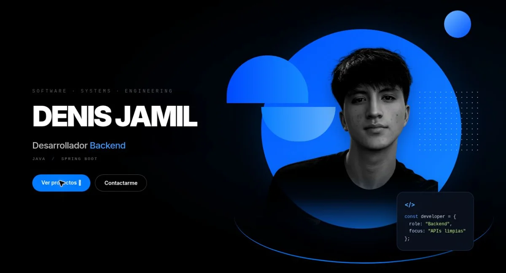
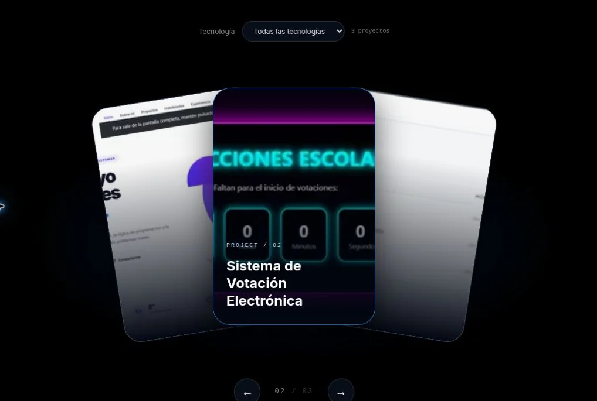
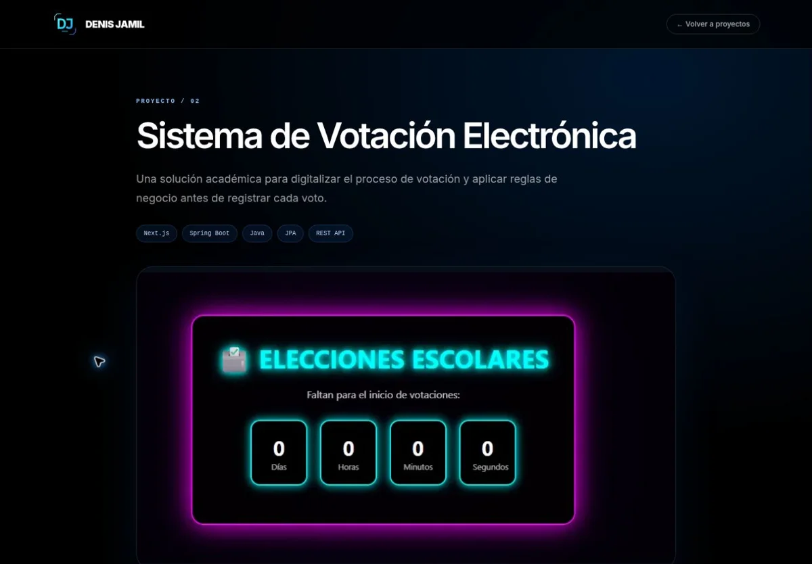

# Portafolio de Denis Jamil Tineo Huancas

Soy estudiante de Ingeniería de Sistemas e Informática en la Universidad Tecnológica del Perú. Me enfoco en el desarrollo backend con **Java, Spring Boot y PostgreSQL**, especialmente en el diseño de APIs REST y la implementación de reglas de negocio.

**[Ver portafolio en línea](https://portafolio-five-lemon-79.vercel.app/)** · [Explorar proyectos](https://portafolio-five-lemon-79.vercel.app/#projects) · [LinkedIn](https://www.linkedin.com/in/denis-jamil-tineo-huancas/)

[](https://portafolio-five-lemon-79.vercel.app/)

## Proyectos destacados

| Proyecto | Qué construí | Tecnologías | Código |
| --- | --- | --- | --- |
| [Sistema de Votación Electrónica](https://portafolio-five-lemon-79.vercel.app/proyectos/sistema-votacion-electronica) | Digitalicé elecciones escolares con validación del estudiante y su mesa, control de votos duplicados y registro de votos. | Java, Spring Boot, JPA, Next.js | [Repositorio](https://github.com/Djamth/SISTEMA-DE-VOTACION-ESCOLAR) |
| [Sistema de Gestión de Usuarios y Módulos](https://portafolio-five-lemon-79.vercel.app/proyectos/sistema-gestion-usuarios-modulos) | Organicé un backend modular con servicios, DTOs, mappers, persistencia y endpoints REST para administrar usuarios y módulos. | Java, Spring Boot, JPA, Maven | [Repositorio](https://github.com/Djamth/SISTEMA-DE-GESTION-DE-USUARIOS-MODULOS) |
| [Portafolio Personal](https://portafolio-five-lemon-79.vercel.app/proyectos/portafolio-personal) | Construí un sitio adaptable con una galería filtrable, fichas individuales y metadatos para buscadores y redes sociales. | Next.js, React, TypeScript, Tailwind CSS | Este repositorio |

## Vistas del sitio

### Galería interactiva

Las tarjetas se despliegan en abanico y se pueden recorrer con las flechas o con gestos táctiles. El filtro permite buscar proyectos por tecnología.

[](https://portafolio-five-lemon-79.vercel.app/#projects)

### Ficha de proyecto

Cada ficha describe el problema, la solución y las funcionalidades, e incluye las tecnologías y el enlace al repositorio.

[](https://portafolio-five-lemon-79.vercel.app/proyectos/sistema-votacion-electronica)

El sitio también reúne mi [stack técnico](https://portafolio-five-lemon-79.vercel.app/#skills), [certificaciones](https://portafolio-five-lemon-79.vercel.app/#certificates), [trayectoria](https://portafolio-five-lemon-79.vercel.app/#experience) y [contacto](https://portafolio-five-lemon-79.vercel.app/#contact).

## Desarrollo local

El sitio publicado se encuentra en [`frontendv1.0.3/`](frontendv1.0.3) y usa Next.js 16, React 19, TypeScript y Tailwind CSS. Los datos de los proyectos y certificaciones se mantienen en [`app/lib/portfolio.ts`](frontendv1.0.3/app/lib/portfolio.ts). La carpeta [`backend/`](backend) contiene un proyecto Spring Boot independiente.

Con Node.js 20.9 o posterior y npm, ejecuta desde la raíz del repositorio:

```bash
cd frontendv1.0.3
npm ci
npm run dev
```

Abre [localhost:3000](http://localhost:3000). Para validar cambios, ejecuta `npm run lint` y `npm run build` desde la misma carpeta.

Vercel publica la rama `main` con `frontendv1.0.3` como directorio raíz. La [guía de despliegue](frontendv1.0.3/README.md) explica cómo configurar `NEXT_PUBLIC_SITE_URL`. Las versiones anteriores están disponibles en [GitHub Releases](https://github.com/Djamth/Portafolio/releases).
